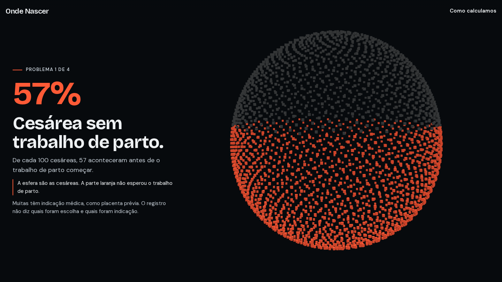

# Onde Nascer

Quanto cada maternidade do Brasil faz de cesárea, com dados abertos do SUS.
Projeto independente: não é site do governo e não é conselho médico.

**Ver no ar:** https://pablorodriguespatinho12-lab.github.io/onde-nascer/



Rodar na sua máquina: `npm install` e `npm run dev`.

## Números (SINASC 2024)
- 2.389.325 nascimentos lidos; 2.712 maternidades com 50+ partos, em 1.829 cidades.
- Cesárea no Brasil: 61,3% no total; 47,8% em gestação de baixo risco (Robson 1 a 4).
- Mediana por maternidade: 70,8%. Em baixo risco, 10% das maternidades ficam abaixo de 20% e 10% acima de 93%.
- Abertura (todos os nascimentos): 57% das cesáreas antes do trabalho de parto; 38% das cesáreas com 37 ou 38 semanas (30% nos partos normais); 34% nascem fora da cidade da mãe; 20% com menos de 7 consultas de pré-natal.
- Conferência: 3 maternidades (SP, BA, RS) recontadas direto no CSV com outro código: as 3 batem.

## Como funciona
1. `dados/processar.py` lê o zip do SINASC em fluxo e conta partos e cesáreas por hospital.
2. `dados/enriquecer.py` busca nome e endereço no CNES e o nome da cidade no IBGE (com cache).
3. O site (Next.js, exportação estática) carrega só o JSON do estado escolhido (~25 KB em média).
4. `dados/gerar_historia.py` junta as maternidades às coordenadas das cidades ([kelvins/municipios-brasileiros](https://github.com/kelvins/municipios-brasileiros), salvo em `dados/bruto/municipios.csv`) e gera `public/historia.json` (21 KB comprimido).
5. A abertura é uma cena em Three.js: 2.712 cubos, um por maternidade, viram esfera, mapa, torres e histograma conforme a rolagem. A posição é calculada na placa de vídeo, e os 128 KB comprimidos do 3D só carregam depois da página.

6. A abertura conta 4 problemas. Em cada um, os cubos tomam uma forma em que a parte colorida tem a proporção do número (`lib/cena/formas.ts`): esfera que enche, dois anéis, esfera menor que se solta e grade de 100 pontos. A cena nunca fica parada: gira nas formas soltas e uma onda atravessa o mapa e o gráfico; luz e cubos reagem ao cursor. A escolha de cidade é em 2 passos: botões de estado e campo de digitar a cidade.

Custo para rodar: R$ 0 (site estático, sem servidor nem banco).

## Rodar
```
curl -o dados/bruto/SINASC_2024_csv.zip https://s3.sa-east-1.amazonaws.com/ckan.saude.gov.br/SINASC/csv/SINASC_2024_csv.zip
npm install
npm run dados
npm run build        # gera out/
```
Para GitHub Pages: `BASE_PATH=/onde-nascer npm run build`.

## Fontes
- SINASC: https://opendatasus.saude.gov.br (Sistema de Informações sobre Nascidos Vivos)
- CNES: https://apidadosabertos.saude.gov.br
- IBGE municípios: https://servicodados.ibge.gov.br/api/docs/localidades
